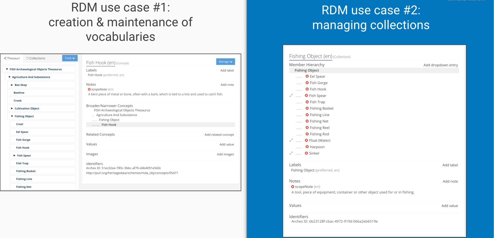

############################################
Choosing Between Controlled Lists and Lingo
############################################

The :ref:`Reference Data Manager (RDM)` is slated for deprecation in Arches 9. Its functionality is being split
between two applications, and which one you migrate to depends on how you use the RDM today.

Two Uses of the RDM
===================

The RDM serves two distinct purposes:

1. **Authoring and maintaining controlled vocabularies.** Thesauri (concept schemes) and their concepts, with
   labels, notes, identifiers and semantic relationships between concepts.
2. **Populating dropdowns in the resource editor.** A branch of a thesaurus is turned into a *collection*, which
   is then assigned to a concept or concept-list node.

    The two RDM use cases: the *Fish Hook* concept in the FISH Archaeological Objects Thesaurus (left) and the
    *Fishing Object* collection (right).

All of this is stored in three database tables: ``concepts`` (the nodes of the hierarchy, typed as
``ConceptScheme``, ``Concept`` or ``Collection``), ``values`` (labels, notes, identifiers, etc.) and
``relations`` (``narrower`` relationships within a thesaurus, ``member`` relationships within a collection).

In the new model, the first use moves to **Arches Lingo** and the second to **Arches Controlled Lists**:

.. list-table::
    :header-rows: 1
    :widths: 40 30 30

    * - In the RDM
      - Moves to
      - Stored as
    * - Concept schemes (thesauri) and their concepts
      - `Arches Lingo <https://github.com/archesproject/arches-lingo/>`_
      - Scheme and Concept resource instances (tile data)
    * - Collections and the concepts that belong to them
      - Arches Controlled Lists
      - Lists, list items and list item values
    * - Domain value / domain value list node options
      - Arches Controlled Lists
      - Lists, list items and list item values

Arches Controlled Lists
=======================

Controlled Lists manages the lists that populate dropdowns, and is expected to replace the most common use of the
RDM. It uses a purpose-built schema (``arches_controlled_lists_list``, ``arches_controlled_lists_listitem`` and
``arches_controlled_lists_listitemvalue``) and the new ``reference`` datatype.

List items are *references* to a concept, not the canonical definition of it. For that reason:

* every list item **requires a URI** pointing to where the concept is defined, whether that is Arches Lingo, the
  Getty AAT, or any other linked data source;
* sort order is stored explicitly on each list item rather than calculated alphabetically.

Arches Lingo
============

Lingo is for managing authority data. Schemes and concepts are first-class Arches resources: their labels,
identifiers, notes and relationships are stored as tiles, and every concept keeps a direct reference to the scheme
it belongs to. Lingo has its own front end, separate from the standard Arches resource editor.

Which Do I Need?
================

**Controlled Lists only.** Most projects do not author authority data. They import vocabularies from an authority
and reference them in their own resources. If that describes your project, migrate your collections to Controlled
Lists and do not install Lingo. You can also create simple lists directly in the Controlled List Manager.

**Lingo.** Choose Lingo if you maintain vocabularies yourself and want to manage them centrally, especially if they
are used by more than one Arches application. For example, the `FISH Thesauri
<https://heritage-standards.org.uk/fish-vocabularies/>`_ can be maintained once in Lingo and referenced by several
`Arches for HERs <https://www.archesproject.org/arches-for-hers/>`_ deployments, instead of maintaining the same
concepts in every instance.

**Both.** Lingo manages *what* the concepts are. Controlled Lists manages *which* of them appear in a given
application's dropdowns. A project that uses Lingo will still use Controlled Lists to load the subset of concepts it
needs, via SKOS import.

.. note::
    Because Lingo concepts are ordinary resource instances, installing Lingo alongside your other resource models
    means they share search, permissions and indexing. Whether Lingo should run in the same instance as your other
    data or in its own instance is a design decision for your project.

To migrate, see :ref:`Migrating from the RDM to Controlled Lists` and :ref:`Migrating Thesauri to Arches Lingo`.
