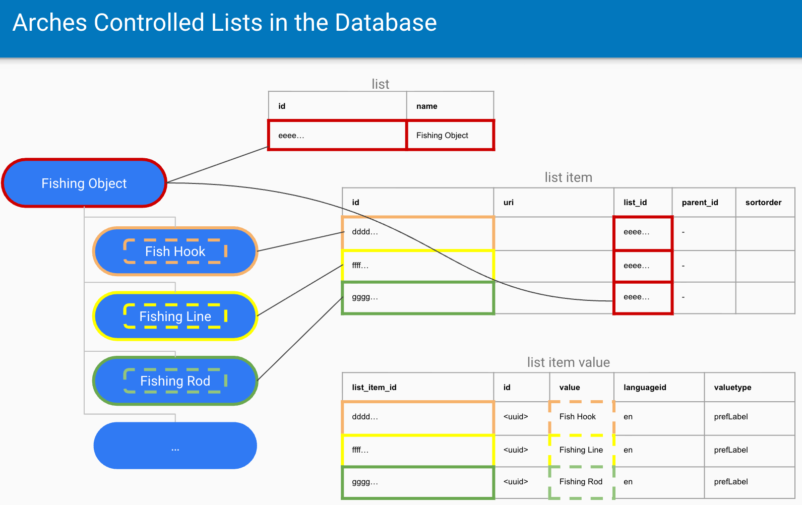
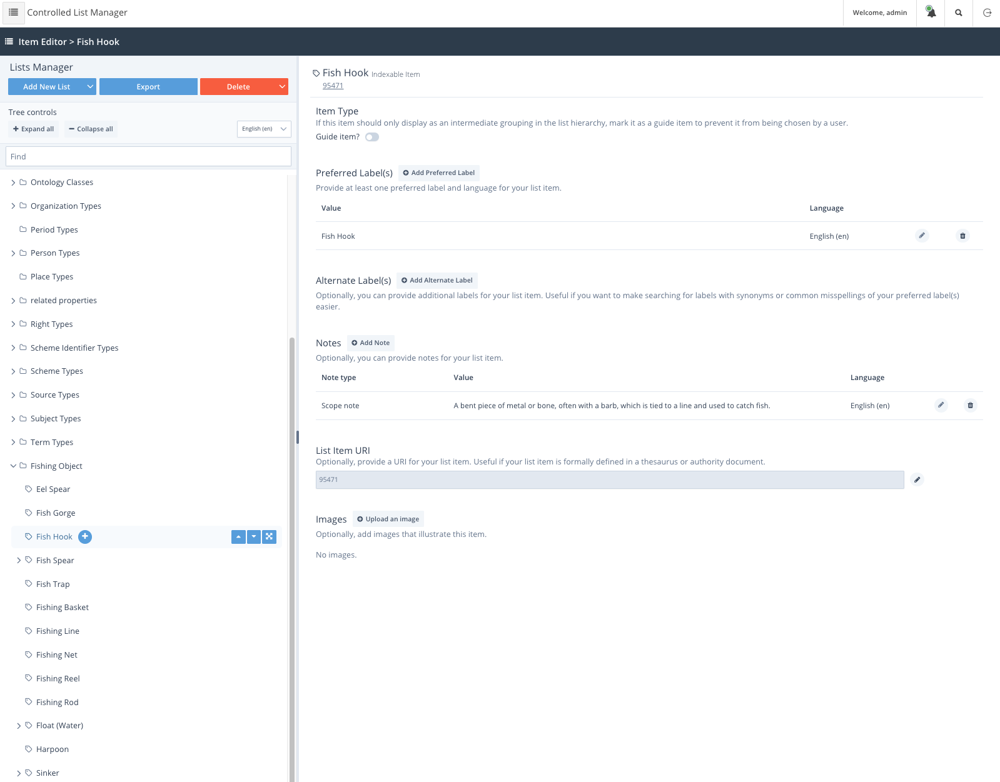

##########################################
Migrating from the RDM to Controlled Lists
##########################################

Arches Controlled Lists includes tools to move RDM collections, domain value lists, and the nodes and tile data that
use them over to controlled lists and the ``reference`` datatype. If you are unsure whether you should be migrating to
Controlled Lists, Arches Lingo, or both, see :ref:`Choosing Between Controlled Lists and Lingo` first.

All operations are run with the ``controlled_lists`` management command:

.. code-block:: bash

    python manage.py controlled_lists -o <operation> [options]

Migration Steps
===============

1. **Clean your data.** Depending on your RDM, this may be anything from nothing at all to a substantial effort.
   See :ref:`Preparing RDM Data for Migration`.
2. **Migrate collections to controlled lists.** See :ref:`Migrating Collections`.
3. **Migrate concept nodes to the reference datatype.** See :ref:`Migrating Concept Nodes`.
4. **Migrate tile data.** See :ref:`Migrating Concept Tile Data`.

Domain value nodes follow the same pattern. See :ref:`Migrating Domain Value Nodes`.

.. warning::
    These operations write directly to the database and publish your graphs. Back up your database before you
    begin, and run the migration against a copy of production data first.

Preparing RDM Data for Migration
================================

Review the collections you plan to migrate before running anything. In particular:

* **URIs.** List items require a URI. If a concept has an ``identifier`` value, it is used as the list item's URI.
  If not, a placeholder URI is minted from the ``--host`` option (see below). Adding real identifiers in the RDM
  first gives better results.
* **Labels.** Each concept should have a ``prefLabel`` in your preferred sort language. Concepts without one are
  sorted using a label in a fallback language.
* **Duplicates and stray concepts.** Anything that is a member of the collection will become a list item.

How RDM Data Map to Controlled Lists
====================================

.. list-table::
    :header-rows: 1
    :widths: 40 60

    * - RDM
      - Controlled Lists
    * - Collection
      - List. The list keeps the collection's ``conceptid`` as its id and its ``prefLabel`` as its name.
    * - Concept that is a member of a collection
      - List item, with the same parent/child hierarchy. The list item keeps the ``conceptid`` as its id where possible.
    * - ``prefLabel``, ``altLabel``, ``hiddenLabel`` and note values (scope notes, definitions, etc.)
      - List item values
    * - ``identifier`` value
      - List item URI. If missing, the URI is ``<host><conceptid>``.
    * - ``sortorder`` value
      - List item sort order. See below.
    * - ``collector`` value
      - The list item's ``guide`` flag

    The *Fishing Object* collection as a list, its member concepts as list items, and their labels as list item
    values.

Things to be aware of:

* **Sort order** is calculated per parent. Concepts with an existing ``sortorder`` value come first; the rest are
  ordered alphabetically by their ``prefLabel`` in the ``--preferred_sort_language``, falling back to another language
  where needed.
* **Polyhierarchies.** A concept that appears in more than one place in a collection, or in more than one migrated
  collection, becomes a separate list item at each location. Only the first occurrence keeps the ``conceptid``; the
  others get new ids.

Migrating Collections
=====================

.. code-block:: bash

    python manage.py controlled_lists -o migrate_collections_to_controlled_lists \
        -co 'Fishing Object' 'Getty AAT' \
        -ho 'https://my-arches.org/plugins/controlled-list-manager/item/' \
        -psl en \
        [-ow]

-co, --collections
    One or more collections to migrate, identified by ``prefLabel`` or ``identifier``. Pass ``''`` as the only
    value to migrate every collection. Escape an apostrophe in a name by doubling it, e.g. ``"John''s list"``.
-ho, --host
    The base used to mint placeholder URIs for concepts that have no ``identifier``. The concept id is appended
    directly, so include a trailing slash. Defaults to
    ``http://localhost:8000/plugins/controlled-list-manager/item/``.
-psl, --preferred_sort_language
    The language code whose ``prefLabel`` is used to sort list items. Must exist in your languages table.
    Defaults to ``en``.
-ow, --overwrite
    Delete and recreate any existing controlled list with the same name. Without this flag the command stops if a
    list with that name already exists.

Collections that can't be found are reported and skipped. When the command completes, the new lists are visible in
the Controlled List Manager.

    Fishing Object list in the Controlled List Manager after migration.

.. tip::
    If you migrated using a placeholder host and later need to change it, use the ``change_url_base`` operation to
    rewrite the scheme and host of existing list item URIs. The path is left unchanged:

    .. code-block:: bash

        python manage.py controlled_lists -o change_url_base \
            -ho 'https://my-arches.org' \
            [-li '<listid>,<listid>']

    ``-li`` limits the change to a comma-separated set of list ids. Without it, all lists are updated.

Migrating Concept Nodes
=======================

Once a node's collection exists as a controlled list, update the node to use the ``reference`` datatype:

.. code-block:: bash

    python manage.py controlled_lists -o migrate_concept_nodes_to_reference_datatype -g <graphid-or-slug>

For every ``concept`` and ``concept-list`` node in the graph, this:

* changes the datatype to ``reference`` (``concept-list`` nodes become multi-value),
* points the node at the controlled list that replaced its collection,
* switches the widget to the reference select widget and converts any default values,
* publishes the graph.

The command checks that every collection used by the graph has been migrated first. If any have not, it lists the
nodes and collection ids involved and makes no changes.

.. note::
    This operation works one graph at a time. If a collection is used by several graphs, run the command for each of
    them. Graphs you don't migrate continue to use the RDM collection.

Migrating Concept Tile Data
===========================

Migrating a node does not change the data already saved against it. Existing tiles still contain RDM value ids
and must be rewritten as references:

.. code-block:: bash

    python manage.py controlled_lists -o migrate_tile_data_to_reference_datatype \
        -g <graphid-or-slug> --origin concept [-l en]

-g, --graph
    The graph id or slug.
--origin
    ``concept`` for nodes that were concept or concept-list nodes; ``domain`` for nodes that were domain value nodes.
-l, --language
    The language of the label used to match a value when its id can't be matched directly. Defaults to
    ``LANGUAGE_CODE``.

The same operation is available in the :ref:`Bulk Data Manager` as **Migrate to Reference Datatype**, which shows
each candidate node, its list and the number of tiles affected before you run it.

Each value is matched to a list item by id first, then by label. If any value in a tile can't be matched, that tile
is left unchanged and a warning is recorded against the load. Review the warnings, correct the lists, and run the
operation again.

Migrating Domain Value Nodes
============================

Domain value and domain value list nodes store their options in the node's configuration rather than in the RDM.
Migrating them is a three-step process.

1. Extract each node's options into a controlled list:

   .. code-block:: bash

       python manage.py controlled_lists -o extract_domain_values_to_controlled_lists \
           -g <graphid-or-slug> \
           [-n <node-alias> <node-alias>] \
           -ho 'https://my-arches.org/plugins/controlled-list-manager/item/' \
           [-ow]

   One list is created per node, named ``<node alias>_<nodeid>``. Each option becomes a list item that keeps the
   option's id where possible, with a URI of ``<host>/<option id>``. Use ``-n`` to limit the operation to specific
   nodes.

2. Migrate the nodes to the reference datatype:

   .. code-block:: bash

       python manage.py controlled_lists -o migrate_domain_nodes_to_reference_datatype \
           -g <graphid-or-slug> [-n <node-alias> <node-alias>]

3. Migrate the tile data, as described in :ref:`Migrating Concept Tile Data`, using ``--origin domain``.

Migrating Thesauri to Arches Lingo
==================================

If you are moving authority data into `Arches Lingo <https://github.com/archesproject/arches-lingo/>`_, the
migration is done from the :ref:`Bulk Data Manager` in an instance with Lingo installed and the RDM data present.
Select **Migrate to Lingo**, choose a concept scheme, and run the import. The scheme and all of its concepts become
Scheme and Concept resources:

* labels (``prefLabel``, ``altLabel``, ``hiddenLabel``) are stored in the label node group,
* identifiers, notes and other values are stored in their corresponding node groups,
* ``narrower`` relationships become broader/top concept relationships, and each concept records the scheme it is
  part of.
